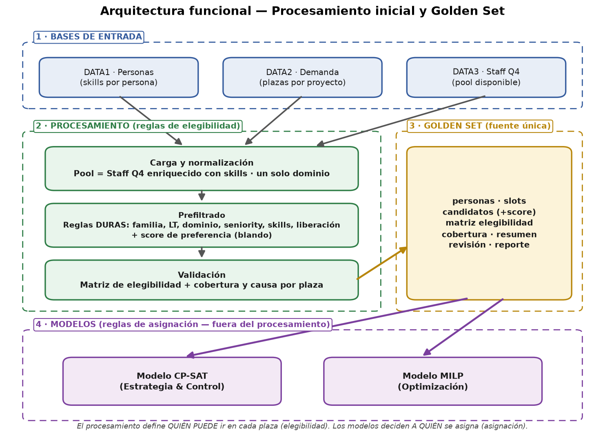
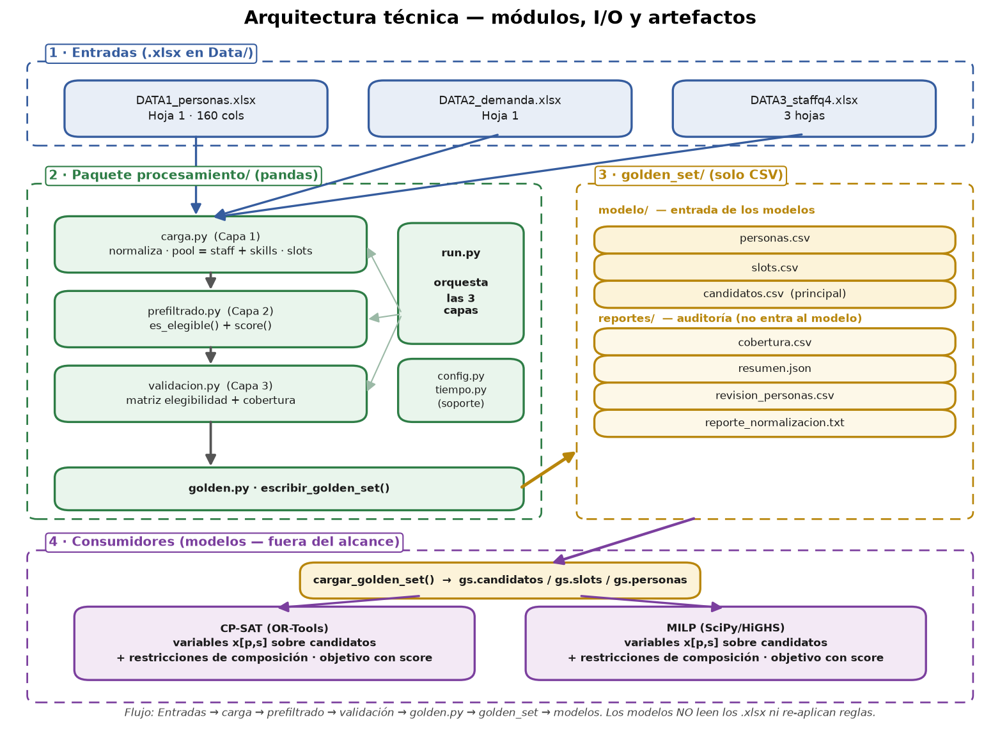

# Reporte de Arquitectura — Procesamiento inicial y Golden Set

Proyecto: **Asignación de Talento 2027**
Componente: `procesamiento/` (etapa previa al modelo de optimización)

Este reporte presenta dos vistas de la misma solución: una **funcional** (qué hace
cada etapa, en lenguaje de negocio) y una **técnica** (módulos, I/O y artefactos).
Las imágenes se generan de forma reproducible con
`docs/generar_diagramas.py` (solo depende de matplotlib).

---

## 1. Arquitectura funcional

Describe el flujo en términos de negocio: de las tres bases de entrada, pasando
por las tres capas de procesamiento que definen la **elegibilidad**, hasta el
golden set que ambos modelos consumen. El procesamiento responde **quién puede ir
en cada plaza**; los modelos responden **a quién se asigna**.



**Lectura del diagrama:**
1. **Bases de entrada** — DATA1 (skills por persona), DATA2 (plazas por proyecto),
   DATA3 (pool de staff disponible).
2. **Procesamiento (reglas de elegibilidad)** — tres capas en cascada:
   - *Carga y normalización*: el pool es el Staff Q4 enriquecido con skills; un
     solo dominio por corrida.
   - *Prefiltrado*: reglas duras (familia, LT, dominio, seniority, skills,
     liberación) que podan, más un score de preferencia blando.
   - *Validación*: matriz de elegibilidad y cobertura con causa por plaza.
3. **Golden set** — fuente única: `personas`, `slots`, `candidatos`, matriz,
   cobertura, resumen y reportes de revisión.
4. **Modelos** — CP-SAT y MILP consumen el golden set. Las reglas de **asignación**
   (composición, cobertura, simultaneidad) viven aquí, fuera del procesamiento.

---

## 2. Arquitectura técnica

Describe la implementación: los Excel de entrada, el paquete Python con sus
módulos y funciones, los artefactos del golden set en sus formatos, y cómo los
consumidores los cargan.



**Lectura del diagrama:**
- **Entradas** — tres `.xlsx` en `Data/`. Solo `carga.py` los lee.
- **Paquete `procesamiento/`** (pandas):
  - `config.py` — flags, catálogo de roles, mapeos.
  - `carga.py` — `cargar_staff`, `cargar_skills`, `construir_pool`, `cargar_slots`.
  - `prefiltrado.py` — `es_elegible()`, `score()`, `construir_candidatos()`.
  - `tiempo.py` — parseo de trimestres y fechas.
  - `validacion.py` — matriz de elegibilidad y cobertura.
  - `run.py` — orquestador de las tres capas.
  - `golden.py` — `escribir_golden_set()` / `cargar_golden_set()`.
- **`golden_set/`** — todo en CSV, separado en dos subcarpetas:
  - `modelo/` — entrada de los modelos: `personas.csv`, `slots.csv`,
    `candidatos.csv` (insumo principal).
  - `reportes/` — auditoría para humanos: `cobertura.csv`, `resumen.json`,
    `revision_personas.csv`, `reporte_normalizacion.txt`. No entran al modelo.
- **Consumidores** — CP-SAT y MILP construyen sus variables `x[p,s]` sobre
  `candidatos`, añaden sus restricciones de composición y su objetivo con el
  `score`. No leen los `.xlsx` ni re-aplican reglas de elegibilidad.

---

## 3. Separación de responsabilidades

| | Procesamiento (este componente) | Modelos (CP-SAT / MILP) |
|---|---|---|
| Pregunta que resuelve | ¿quién **puede** ir en cada plaza? | ¿a **quién** se asigna? |
| Reglas | elegibilidad (duras) + score (blando) | composición / optimización |
| Entrada | 3 Excel | golden set |
| Salida | golden set | asignación final |
| Fuente de verdad de elegibilidad | **sí** (única) | la consumen, no la recalculan |

El contrato de uso del golden set (qué pueden y qué no pueden hacer los modelos)
está en `DOCUMENTACION_E2E.md`, §8.1.

---

## 4. Regenerar las imágenes

```bash
python docs/generar_diagramas.py
```

Reescribe `docs/arquitectura_funcional.png` y `docs/arquitectura_tecnica.png`. El
script no lee datos: dibuja la arquitectura, de modo que las imágenes son estables
y versionables junto al código.
